# DCC 2026 통합 EDA 보고서

> 생성 시각(UTC, 협정 세계시): `2026-09-21T05:31:49.497103+00:00`  
> 재현 seed(난수 생성 초기값): `42` · JSON(구조화 라벨 파일)/WAV(음성 파일) 헤더(기본 메타정보): 전수 · 파형: 층화 표본(그룹별 비율을 유지한 표본 추출)

## 1. 데이터 개요

| Split(데이터 분할) | Manifest(파일 연결 목록) | JSON 성공 | WAV 헤더 오류 | 통화 길이 중앙값(가운데 값) | 발화 수 중앙값(가운데 값) |
|---|---:|---:|---:|---:|---:|
| Training | 29,200 | 29,200 | 0 | 65.64초 | 29.0개 |
| Validation | 3,640 | 3,640 | 0 | 65.76초 | 29.0개 |

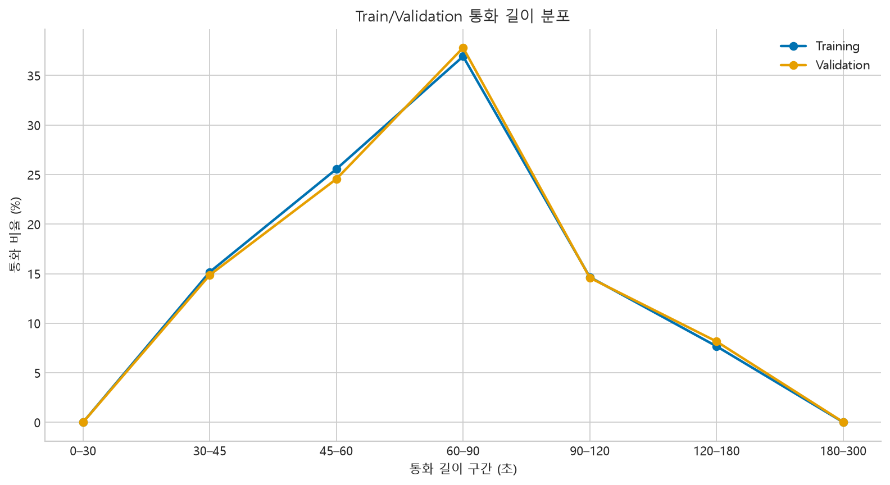

## 2. 데이터 품질

- Training: 발화 구간이 하나 이상 겹치는 통화 28,659건 (98.15%) — 동시 발화와 라벨링 관행을 함께 검토해야 함
- Validation: 발화 구간이 하나 이상 겹치는 통화 3,559건 (97.77%) — 동시 발화와 라벨링 관행을 함께 검토해야 함
- Train/Validation 정규화 전사(공백·대소문자 등을 통일한 텍스트) 해시(원문 대신 사용하는 지문값) 중복 1개
- JSON 통화 길이 − WAV 길이 중앙값(가운데 값): Training 0.000ms(밀리초), Validation 0.000ms(밀리초)
- 주소와 원문 전사는 산출물에 저장하지 않았으며, 전사 중복은 SHA-256 해시(원문을 복원하지 않고 동일 여부만 비교하는 지문)로만 비교했습니다.

## 3. Mission 1 — 신고자 성별

| Split(데이터 분할) | F(여성) | M(남성) | 신고자 음성 중앙값(가운데 값) | 신고자 발화 수 중앙값(가운데 값) |
|---|---:|---:|---:|---:|
| Training | 53.23% | 46.77% | 30.22초 | 15.0개 |
| Validation | 53.82% | 46.18% | 30.50초 | 15.0개 |

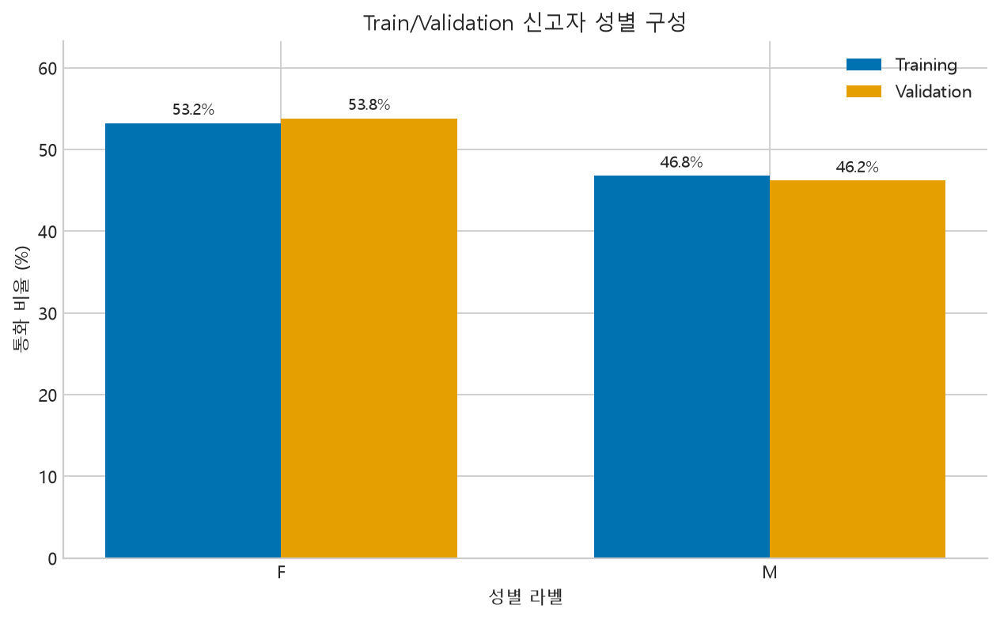

성별 비율뿐 아니라 성별별 신고자 발화량과 표본 음향 특징을 함께 확인해야 길이 차이를 성별 신호로 오인하는 위험을 줄일 수 있습니다.

## 4. Mission 2 — 화자 구분

| 화자 | 발화 수 | 발화 비율 | 길이 중앙값(가운데 값) | 길이 p90(90%가 이 값 이하인 지점) |
|---|---:|---:|---:|---:|
| 119대원 (0) | 427,161 | 48.03% | 1.402초 | 3.640초 |
| 신고자 (1) | 462,197 | 51.97% | 1.490초 | 4.661초 |

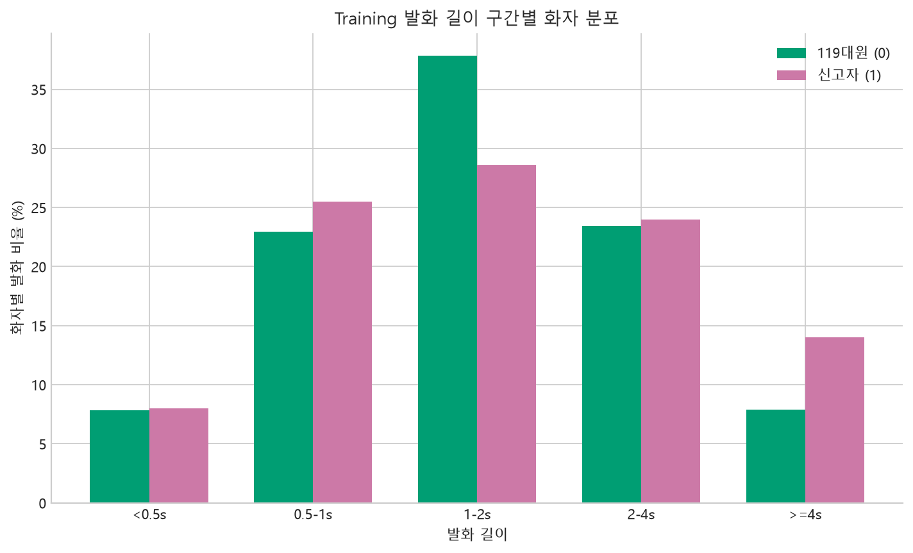

발화 길이는 화자와 연관될 수 있지만 대화 구조에 의한 편향일 수 있으므로, 단독 결정 변수로 해석하지 않습니다. 겹침·짧은 맞장구 구간은 별도 오류 분석 대상으로 둡니다.

## 5. Mission 3 — 증상 다중 레이블

| 증상 | Training 건수 | Training 비율 | Validation 건수 | Validation 비율 |
|---|---:|---:|---:|---:|
| 고열 | 5,186 | 17.76% | 678 | 18.63% |
| 구토 | 4,463 | 15.28% | 537 | 14.75% |
| 두통 | 2,905 | 9.95% | 374 | 10.28% |
| 복통 | 6,771 | 23.19% | 838 | 23.02% |
| 어지러움 | 6,334 | 21.69% | 774 | 21.26% |
| 열상 | 3,465 | 11.87% | 463 | 12.72% |
| 오심 | 3,341 | 11.44% | 429 | 11.79% |
| 전신쇠약 | 5,310 | 18.18% | 651 | 17.89% |
| 호흡곤란 | 3,927 | 13.45% | 492 | 13.52% |

- Training label cardinality(통화 하나에 붙은 평균 증상 레이블 수) 평균: 1.428
- 목표 9개 증상이 하나도 없는 통화: Training 0건, Validation 0건
- Validation token OOV(학습 데이터에 없었던 단어): 13,229/425,990 (3.11%)

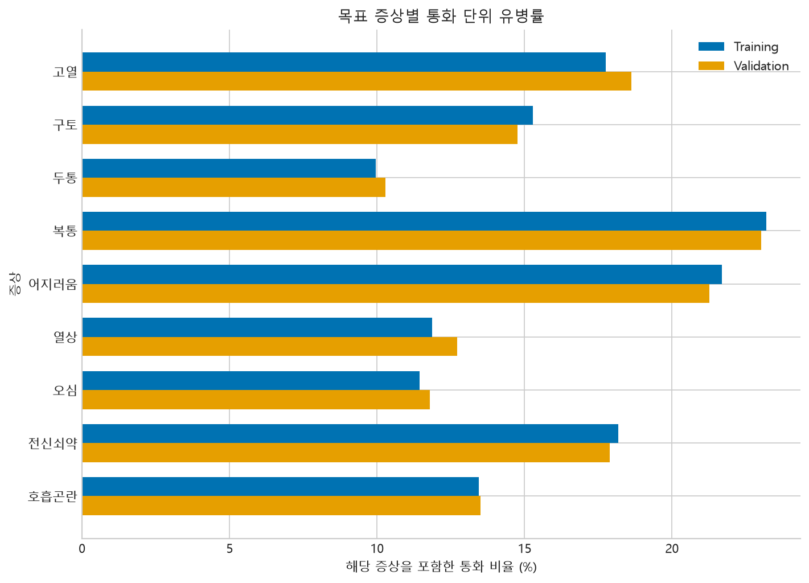

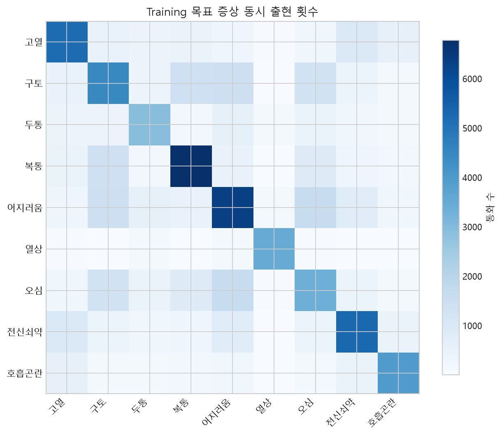

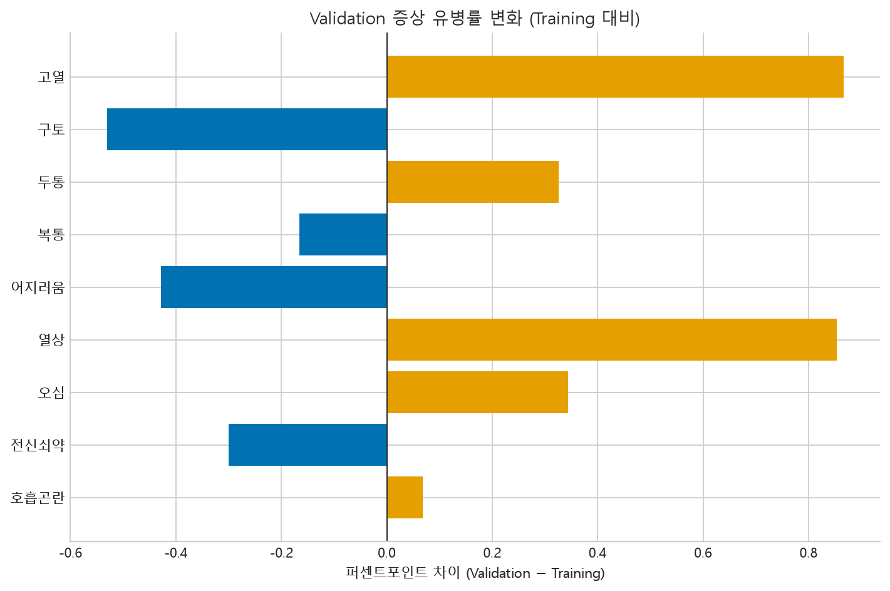

Macro F1(각 증상별 F1 점수를 같은 비중으로 평균낸 지표) 관점에서는 희소 증상의 표본 수와 동시 출현 구조를 함께 고려해야 합니다. Validation 분포 차이는 설명용이며 threshold(분류 여부를 결정하는 기준값)나 모델을 반복 조정하는 근거로 사용하지 않습니다.

## 6. 파형 표본 분석

- Training: 1,000통화 선택, 1,000통화 성공, 2,000개 화자 벡터, 실패 0건
- Validation: 400통화 선택, 400통화 성공, 800개 화자 벡터, 실패 0건

| Split / 화자 | 연결 음성 중앙값(가운데 값) | RMS(평균 음량 크기) 중앙값 | ZCR(신호 부호 변화율) 중앙값 | spectral centroid(주파수 에너지 중심) 중앙값 | 무음 비율 중앙값 |
|---|---:|---:|---:|---:|---:|
| Training / 119대원 | 23.77초 | 0.0605 | 0.1952 | 1060.1Hz | 36.48% |
| Training / 신고자 | 29.86초 | 0.0660 | 0.1682 | 888.9Hz | 32.91% |
| Validation / 119대원 | 23.51초 | 0.0560 | 0.1974 | 1068.4Hz | 38.71% |
| Validation / 신고자 | 31.08초 | 0.0655 | 0.1689 | 898.6Hz | 34.04% |

- 각 화자의 발화를 통화 단위로 연결하고 최대 15초를 사용해 MFCC(음색을 요약하는 음향 특성)/RMS(평균 음량 크기)/ZCR(신호 부호 변화율)/spectral(주파수 관련) 53차원 스키마를 EDA(탐색적 데이터 분석)용 NumPy(수치 계산 라이브러리) 구현으로 계산했습니다. 주파수 단위 Hz는 헤르츠(초당 진동 횟수)입니다. 모델 파이프라인의 librosa(음성 분석 라이브러리) 특징과 수치 동일성을 보장하지 않으며, 표본 결과는 인과적 증거(원인이라고 확정할 근거)가 아닙니다.

## 7. 심화 분석 — 분포 이동·겹침·효과크기

> 전수(32,840통화) JSON에서 집계 통계만 계산했고 전사 원문·주소·식별자는 저장하지 않았습니다 (`reports/eda/eda_deep_summary.json`). **Cliff's δ**(효과크기: 한 집단 값이 다른 집단보다 클 확률 − 작을 확률, −1~1)는 |δ| 0.147 미만 무시할 수준, 0.33 미만 작음, 0.474 미만 중간, 그 이상 큼으로 읽습니다. 표본이 매우 커서 p-value는 의사결정 기준으로 쓰지 않고 효과크기와 신뢰구간으로 판단합니다.

### 7.1 Training ↔ Validation 분포 이동

| 변수 | Training 중앙값 | Validation 중앙값 | KS(누적분포 최대 차이) | Wasserstein(분포 이동 거리) | 표준화 평균차(Valid−Train) |
|---|---:|---:|---:|---:|---:|
| 통화 길이 | 65.640초 | 65.760초 | 0.0146 | 0.5276 | +0.0143 |
| 통화당 발화 수 | 29.000개 | 29.000개 | 0.0180 | 0.3415 | +0.0260 |
| 신고자 발화 비중 | 0.468 | 0.467 | 0.0129 | 0.0016 | -0.0082 |

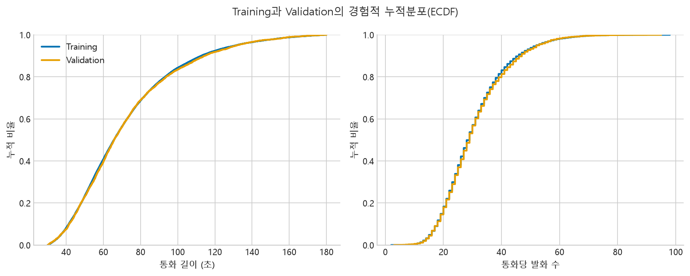

### 7.2 발화 겹침 (M2 오류 슬라이스 설계)

| Split | 겹침 있는 통화 | 화자 간 겹침 통화 | 통화당 겹침시간 비율 중앙값 | p90 | 0.1초 이하 겹침 쌍 |
|---|---:|---:|---:|---:|---:|
| Training | 98.15% | 96.43% | 3.82% | 9.96% | 41.0% |
| Validation | 97.77% | 96.24% | 3.88% | 9.96% | 40.8% |

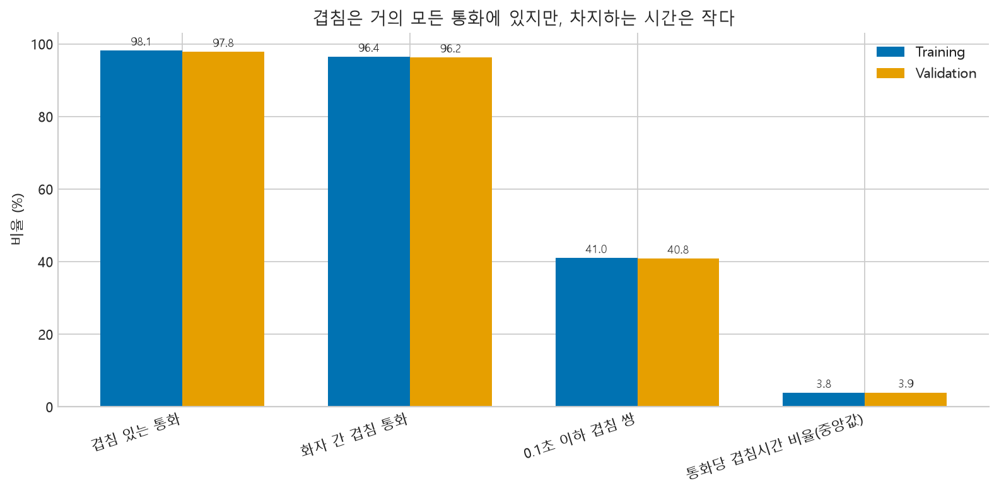

### 7.3 성별 효과 (M1 shortcut 점검)

| 변수 | 여성 중앙값 | 남성 중앙값 | Cliff's δ(여−남) | 효과 크기 | 중앙값 차이 95% 구간 |
|---|---:|---:|---:|---|---|
| 통화 길이 | 66.600 | 64.680 | +0.044 | 무시할 수준 | +1.920 [+1.200, +2.640] |
| 신고자 발화 시간 | 31.396 | 28.986 | +0.103 | 무시할 수준 | +2.410 [+2.039, +2.755] |
| 신고자 발화 수 | 15.000 | 14.000 | +0.047 | 무시할 수준 | +1.000 [+0.000, +1.000] |
| 신고자 발화 비중 | 0.479 | 0.455 | +0.118 | 무시할 수준 | +0.024 [+0.021, +0.027] |

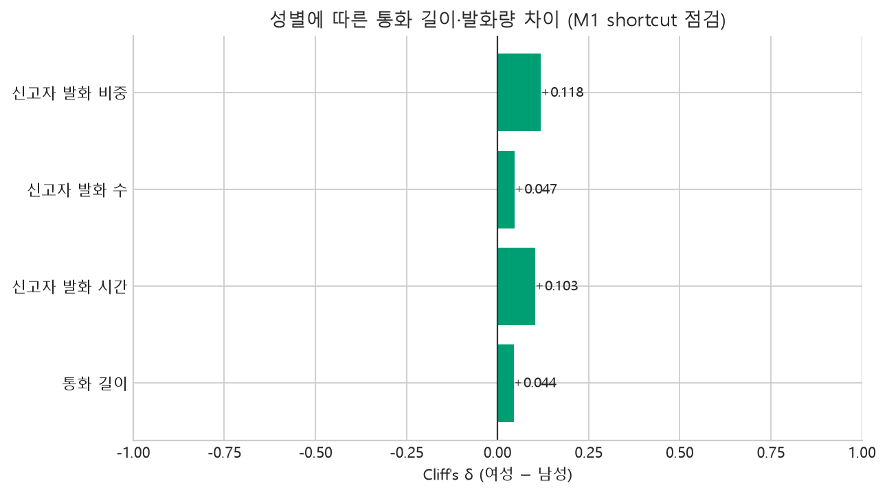

### 7.4 화자별 발화 길이 (M2)

| Split | 화자 | 발화 수 | 중앙값 | p90 | 0.5초 미만 | 1초 미만 | 4초 이상 |
|---|---|---:|---:|---:|---:|---:|---:|
| Training | 119대원 | 427,161 | 1.402초 | 3.640초 | 7.9% | 30.8% | 7.9% |
| Training | 신고자 | 462,197 | 1.490초 | 4.661초 | 8.0% | 33.5% | 14.0% |
| Validation | 119대원 | 53,845 | 1.399초 | 3.638초 | 8.0% | 31.2% | 7.9% |
| Validation | 신고자 | 58,102 | 1.485초 | 4.672초 | 8.0% | 33.6% | 14.1% |

- Training: 발화 단위 Cliff's δ(신고자−119대원) +0.046(무시할 수준), 같은 통화 안에서 신고자의 중앙 발화가 더 긴 통화의 우세도 +0.122
- Validation: 발화 단위 Cliff's δ(신고자−119대원) +0.045(무시할 수준), 같은 통화 안에서 신고자의 중앙 발화가 더 긴 통화의 우세도 +0.114

### 7.5 증상 공출현 구조 (M3 Macro F1)

- 통화당 레이블 수 분포: 1개 66.9%, 2개 24.5%, 3개 7.4%, 4개 1.1%, 5개 0.1% (2개 이상 33.1%)

| 가장 흔한 레이블 조합 | 통화 수 | 비율 |
|---|---:|---:|
| 복통 | 4,457 | 13.57% |
| 열상 | 3,592 | 10.94% |
| 전신쇠약 | 3,024 | 9.21% |
| 고열 | 2,951 | 8.99% |
| 호흡곤란 | 2,827 | 8.61% |

| Lift 상위(함께 나오기 쉬움) | Lift | Jaccard |
|---|---:|---:|
| 구토 · 오심 | 2.542 | 0.200 |
| 어지러움 · 오심 | 2.256 | 0.204 |
| 구토 · 어지러움 | 1.521 | 0.157 |

| Lift 하위(함께 나오기 어려움) | Lift | Jaccard |
|---|---:|---:|
| 복통 · 열상 | 0.005 | 0.000 |
| 열상 · 호흡곤란 | 0.011 | 0.001 |
| 열상 · 전신쇠약 | 0.035 | 0.003 |

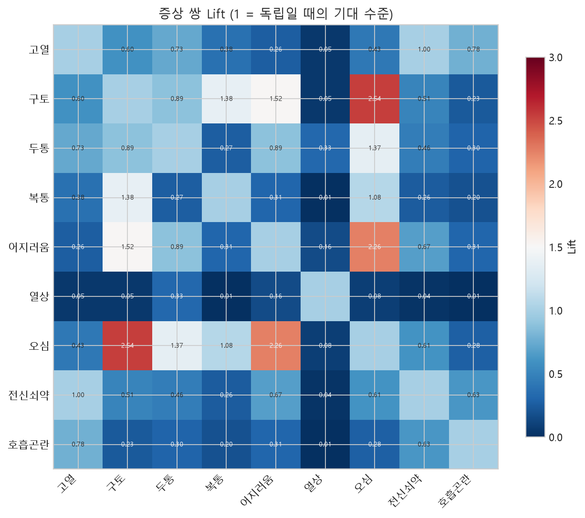

### 7.6 화자·성별 음향 효과 (M1/M2, 층화 표본)

| 특징 | Training δ(신고자−119대원) | Validation δ | 효과 크기(Training) |
|---|---:|---:|---|
| 연결 음성(초) | +0.293 | +0.325 | 작음 |
| RMS | +0.139 | +0.176 | 무시할 수준 |
| ZCR | -0.575 | -0.582 | 큼 |
| Spectral centroid | -0.718 | -0.703 | 큼 |
| 무음 비율 | -0.197 | -0.247 | 작음 |

| 신고자 음향 특징 | Cliff's δ(여성−남성) | 효과 크기 |
|---|---:|---|
| 연결 음성(초) | +0.018 | 무시할 수준 |
| RMS | -0.106 | 무시할 수준 |
| ZCR | +0.078 | 무시할 수준 |
| Spectral centroid | +0.029 | 무시할 수준 |

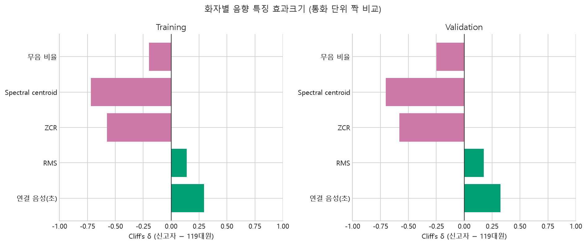

### 7.7 Mission별 시사점

- **M1**: 통화 길이·발화량·음량·ZCR·spectral centroid 어느 것도 성별을 의미 있게 구분하지 못합니다(최대 |δ| 0.118). 길이 기반 shortcut 위험은 낮지만, 성별 신호는 이 요약 특징이 아니라 MFCC 등 세부 스펙트럼 특징에 있을 것으로 추정되므로 오류 분석에서 확인합니다.
- **M2**: 통화의 98.1%에 겹침이 있어 '겹침 유무'는 슬라이스로 쓸 수 없고, 통화당 겹침시간 비율(중앙값 3.8%, p90 10.0%) 상위 구간을 슬라이스 후보로 제안합니다(baseline 오류와의 연관은 별도 검증 필요). 발화 길이의 화자 효과는 무시할 수준(δ +0.046)이라 길이만으로 화자를 구분하긴 어렵고, 음향 요약 중 효과가 가장 큰 것은 Spectral centroid(Training δ -0.718, Validation δ -0.703, 큼)입니다.
- **M3**: 2개 이상 레이블 통화가 33.1%이므로 단일 레이블 가정은 맞지 않습니다. Lift가 가장 높은 쌍은 구토·오심(2.54), 가장 낮은 쌍은 복통·열상(0.01)입니다.
- **공통**: Training↔Validation KS 통계량 최대값은 0.0180(분포가 매우 유사)이며, Validation 점수가 Training 분포 가정에서 크게 벗어나지 않는지 해석의 전제로 사용합니다.


## 8. 권고사항

1. M1은 통화 길이·발화량·음량·ZCR·spectral centroid의 성별 효과가 모두 무시할 수준(최대 |δ| 0.118)이라 길이 기반 shortcut(본질적인 신호 대신 우연한 쉬운 단서를 학습하는 현상) 위험은 낮다고 봅니다. 오류 분석은 통화 길이·신고자 발화 시간 구간별 정확도를 확인하는 수준으로 두고, 개선 실험은 MFCC 등 세부 스펙트럼 특징을 우선 시도합니다.
2. M2는 겹침 유무(통화의 98%에 해당)가 아니라 통화당 겹침시간 비율 상위 구간(p90 10.0% 이상), 0.5초 미만 발화(최대 8.0%)와 1초 미만 발화(최대 33.5%), 단일 화자 비중이 큰 통화를 고정 오류 슬라이스(특정 조건으로 나눈 오류 분석 구간)로 둡니다. 또한 Spectral centroid의 화자 효과가 큼(δ -0.718)이므로 해당 특징을 뺀 ablation(특징 제거 비교)으로 모델이 녹음 채널 차이에 의존하는지 점검합니다.
3. M3는 2개 이상 레이블 통화가 33.1%이므로 희소 레이블과 공출현 조합을 보존하는 multilabel stratification(여러 레이블 조합의 비율을 유지하는 분할 방식)을 유지합니다. 공출현이 두드러진 구토·오심(Lift 2.54) 쌍은 오류 분석에서 함께 틀리는지 확인하고, 거의 함께 나오지 않는 복통·열상(Lift 0.01) 쌍은 상호배타 후처리가 이득인지 Training 교차검증으로 검토합니다(Validation은 반복 조정에 쓰지 않음).
4. Training↔Validation 분포 차이는 KS 최대 0.018로 작아 Validation 점수를 Training 분포의 대리 지표로 해석할 수 있습니다. 식별자 중복은 0건이고 전사 해시 중복 1건은 원문을 노출하지 않는 별도 수동 감사 대상으로 둡니다.
5. 본 보고서는 기술통계이며 상관관계를 원인으로 해석하지 않습니다. 음향 효과는 층화 표본(Training 1,000 · Validation 400통화, 통화당 최대 15초) 기준이라 전수 결과로 일반화하지 않습니다.

## 재현 방법

```bash
python scripts/eda_dcc_dataset.py
python scripts/eda_deep_dive.py  # 심화 분석 절(7장) 생성
```

개발용 smoke run은 `--json-max-train`, `--json-max-val`, `--waveform-sample-train`, `--waveform-sample-val`로 범위를 제한합니다.
