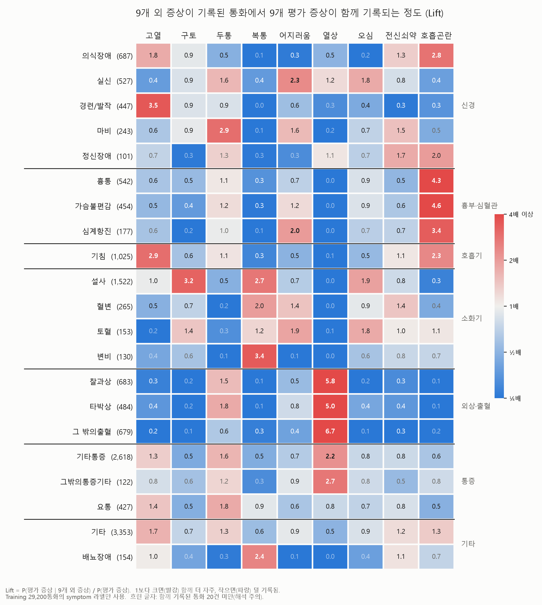

# Mission 3 오류 분석 — 왜 오심·두통·전신쇠약이 낮은가

- 대상: 80:20 multilabel stratified holdout 5,792건 (Training만 사용, 공식 Val 미사용)
- 예측: P0 TF-IDF+LR (`../m3_reeval_tfidf_lr/validation_predictions.csv`, Macro F1 0.5676)
  - 1~3절은 TF-IDF 예측 기준이다. **4절에서 최종 후보 KcBERT(KCBERT-005 seed 42)와 앙상블로 다시 확인했고, 결론은 같다.**
- "텍스트 근거"는 증상별 정규식(`m3_error_analysis.py`의 `KW`)으로 판정했다. 구어체 변형을 다 잡지는 못하므로 근거 비율은 **하한값**이다.
- 저장 파일은 집계값뿐이다(`m3_error_analysis.json`). 전사 원문은 저장하지 않는다.

## 1. 핵심 발견: 라벨의 상당수는 통화 안에 근거가 없다

| 증상 | F1 | 양성 중 표현이 있는 비율 | 근거 있는 양성 recall | 근거 없는 양성 recall |
|---|---|---|---|---|
| 열상 | 0.804 | 62% | 0.965 | 0.766 |
| 복통 | 0.736 | 58% | 0.948 | 0.343 |
| 호흡곤란 | 0.631 | 70% | 0.861 | 0.306 |
| 어지러움 | 0.607 | 51% | 0.887 | 0.382 |
| 고열 | 0.601 | 53% | 0.869 | 0.376 |
| 전신쇠약 | 0.523 | 24% | 0.907 | 0.549 |
| 구토 | 0.486 | 51% | 0.829 | 0.202 |
| 두통 | 0.409 | 36% | 0.820 | 0.195 |
| **오심** | **0.312** | **11%** | 0.684 | 0.356 |

- 증상 표현이 통화에 있으면 TF-IDF도 recall이 0.8~0.97입니다. **모델의 표현 이해력은 병목이 아닙니다.**
- 점수가 낮은 증상일수록 근거 없는 양성이 많습니다. 오심은 양성 668건 중 592건(89%)에 메스꺼움 표현이 없습니다. 417건(62%)에는 구토 표현도 없습니다.
- 표본을 직접 읽어 확인했습니다. 오심 라벨이 붙은 통화도 대화는 "어지러워서 정신을 못 차리겠다", "더위 먹어 쓰러질 것 같다", "백신 맞고 열이 난다", "말을 잘 못한다" 같은 내용입니다. 메스꺼움 언급은 없습니다. 라벨은 통화 뒤에 얻은 정보(현장 평가 등)로 붙은 것으로 보입니다.
- 반대 방향도 일관되지 않습니다. 메스꺼움 표현이 있는 171건 중 오심 라벨은 76건(44%)에만 붙어 있습니다.

## 2. 모델이 틀리는 방식: 근거가 없으니 함께 나오는 증상으로 추측한다

- 오심 FP 754건의 실제 라벨(중복 포함): 어지러움 299, 복통 250, 구토 231. 모델이 "어지러움·복통·구토 맥락이면 오심도 있을 것"이라는 공출현 확률을 배운 결과입니다. 구토·오심의 Lift는 2.54입니다.
- 이 추측이 맞는 경우도 있어 recall 0.39는 나옵니다. 하지만 같은 맥락의 음성 통화가 훨씬 많아서 precision이 0.26에 머뭅니다.
- 두통 FP의 실제 라벨은 어지러움(162)이 1위입니다. 전신쇠약 FP는 어지러움·고열·호흡곤란입니다. 모두 비특이적이고 함께 나오는 증상입니다.

## 3. 해결 방향

| 방향 | 기대 | 판단 |
|---|---|---|
| 인코더·입력 길이·앙상블 개선 | 근거 있는 샘플은 이미 잘 맞힘 | 오심·두통에는 효과 없음. KCBERT-004~008, KLUEBERT, ROBERTA 결과와 일치하므로 **중단** |
| 손실 가중(pos_weight) 강화 | 근거가 약한 증상에서 양성 판정을 늘려 F1 균형을 맞춤 | 실제로 오심 0.237→0.283 (KCBERT-005). **이미 적용됨** |
| 증상별 pos_weight 차등 (오심·두통·전신쇠약만 강화) | 근거 없는 증상의 recall 추가 확보 | 사실상 threshold를 증상별로 옮기는 효과라 **회색지대**. 10/10 멘토링 질의 후 결정 |
| 공출현을 명시적으로 모델링 (라벨 의존 헤드 등) | 모델이 이미 공출현을 쓰고 있어 추가 이득 작음 | 우선순위 낮음 |
| 메타데이터(triage, disasterMedium) 사용 | 근거 보완 | **규정상 금지**. M3 입력은 전사 text만 허용 |
| 화자 구분 입력 (신고자 발화만 등) | 상담원 질문("머리 아프세요?")과 실제 증상 구분 | 원천 speaker 번호가 일정하지 않아(0번이 상담원이 아닌 통화 있음) 효과 검증이 먼저 필요 |

**결론**: 오심·두통·전신쇠약의 낮은 점수는 **모델이 아니라 데이터 한계**(통화 안에 근거가 없는 라벨) 때문입니다. 텍스트만으로 얻을 수 있는 상한이 낮습니다. 남은 레버는 근거 있는 샘플을 놓치지 않는 것과, 근거 없는 증상의 판정 균형을 맞추는 것(손실 가중) 정도입니다.

## 4. 최종 후보 모델로 다시 확인 (2026-10-10)

비교 대상은 TF-IDF(P0), KcBERT(KCBERT-005 seed 42), 앙상블(KcBERT 0.55 + TF-IDF 0.45 확률 평균)이다. 앙상블 가중치는 홀드아웃에서 골랐다. 판정은 `>= 0.5`이다.
홀드아웃 5,792건과 공식 Validation 3,640건에서 같은 경향이 나왔다. 아래 표는 공식 Val 값이다. 집계 파일은 `m3_error_analysis_models.json`이다.

| | TF-IDF | KcBERT | 앙상블 |
|---|---|---|---|
| Macro F1 | 0.569 | 0.625 | **0.635** |
| Macro precision / recall | 0.533 / 0.616 | 0.704 / 0.564 | 0.702 / 0.582 |
| **근거 있는** 양성 recall (2,515개) | 0.889 | 0.886 | **0.905** |
| **근거 없는** 양성 recall (2,721개) | **0.390** | 0.297 | 0.316 |
| 부정된 키워드에서 낸 FP ("열은 없어요" 등) | 97 | **56** | 68 |
| 빈 예측 행 | 183 | 299 | 306 |

**4.1 남은 오답은 거의 전부 "근거 없는 라벨"이다**
- 두 모델이 **모두 놓친** 양성은 1,590개다. 그중 **92%(1,465개)가 통화에 근거가 없는 라벨**이다. 홀드아웃도 92.4%다.
- 통화에 근거가 있는 라벨은 이미 약 90%를 맞힌다. 최종 모델로 봐도 남은 개선 여지는 텍스트로 알 수 없는 정보에 있다.

**4.2 두 모델은 실수하는 방식이 달라서 앙상블이 효과가 있다**
- **TF-IDF는 넓게 추측한다.** 근거 없는 라벨의 recall이 더 높다(0.39 vs 0.30). 대신 KcBERT가 내지 않는 FP를 2,048개 더 낸다. KcBERT만 내는 FP는 405개다.
- **KcBERT는 정밀하다.** precision이 0.70으로 높다. 부정 표현도 더 잘 걸러서, 부정된 키워드에서 내는 FP가 TF-IDF의 약 절반이다(56 vs 97). "숨은 안 차요"처럼 키워드만 보면 틀리기 쉬운 문맥을 이해한다는 뜻이다.
- **앙상블은 둘의 장점을 합친다.** 근거 있는 라벨의 recall이 두 모델보다 높고(0.905), precision은 KcBERT 수준으로 유지된다. 그래서 공식 Val에서 9개 증상 F1이 모두 올랐다.

**4.3 KcBERT가 근거가 있는데도 놓치는 증상**
- 호흡곤란: 근거 있는 recall이 TF-IDF 0.832, KcBERT 0.763이다.
- 전신쇠약: 근거 있는 recall이 TF-IDF 0.893, KcBERT 0.765이다.
- 두 증상은 키워드가 상담원 안내("호흡 천천히 하세요")나 다른 증상 설명에도 자주 나온다. 그래서 KcBERT가 보수적으로 판단하는 것으로 보인다(추정, 사례 확인 전). 앙상블이 이 부분을 일부 메운다(0.802 / 0.799).

**4.4 PPT 시사점**
- **텍스트만으로 얻을 수 있는 성능의 상한이 명확하다.** 남은 오답의 92%는 통화에 근거가 없는 라벨이다. 신고 통화로 판단한 증상과 현장 기록 사이에 차이가 있다는 뜻이며, 사회안전 측면의 시사점이다(통화만으로 하는 증상 판단의 한계, 현장 정보와 함께 써야 할 필요).
- **모델 선택의 근거가 된다.** 문맥을 이해하는 모델(KcBERT)과 키워드 기반 모델(TF-IDF)은 서로 보완적이다. 그래서 앙상블을 쓴다.

## 5. 9개 외 증상과 9개 평가 증상의 관계 (Lift, 2026-10-10)



Training 29,200통화의 `symptom` 라벨만 썼습니다(전사·다른 필드 미사용). 행은 Training에서 100건 이상인 9개 외 증상 21종이고, 임상 계통 순으로 정렬했습니다. 표 데이터는 `figures/m3_nontarget_lift.csv`에 있습니다.
Training 통화의 40%(11,761건)에 9개 외 증상이 하나 이상 있습니다.

- **외상 → 열상:** 그 밖의출혈 6.7배, 찰과상 5.8배, 타박상 5.0배.
- **흉부 → 호흡곤란:** 가슴불편감 4.6배, 흉통 4.3배, 심계항진 3.4배.
- **소화기 → 구토·복통:** 설사는 구토 3.2배·복통 2.7배, 변비는 복통 3.4배.
- **신경계는 증상마다 패턴이 다릅니다:** 경련/발작은 고열 3.5배(열성 경련으로 추정), 마비는 두통 2.9배, 실신은 어지러움 2.3배, 의식장애는 호흡곤란 2.8배.
- **기침 → 고열·호흡곤란:** 각각 2.9배, 2.3배.
- **반대 방향도 뚜렷합니다:** 외상 계열에서는 고열·구토·오심이 0.1~0.4배로 거의 함께 기록되지 않습니다.

**시사점**
- 9개 외 증상은 통화가 **어떤 상황인지(외상, 흉부, 소화기, 신경)를 강하게 구분**합니다. 4.1절에서 남은 오답의 92%가 통화에 근거 없는 라벨이었는데, 이런 라벨은 상황에 따라 함께 기록되는 경향이 있습니다.
- 그래서 9개 외 증상을 보조 목표로 함께 학습하면(M3-ROBERTA-004), 인코더가 상황 맥락을 더 잘 표현할 것으로 기대합니다.
- 다만 Lift는 라벨이 함께 기록되는 경향일 뿐, 인과관계는 아닙니다.

## 재현

```bash
python reports/mission3/error_analysis/m3_error_analysis_models.py <probs_dir> <holdout_label_dir> <Validation/2.라벨링데이터> reports/mission3/error_analysis/m3_error_analysis_models.json
```

`<probs_dir>`에는 `p0_holdout.npz`, `p0_val.npz`, `k5_holdout.npz`, `k5_val.npz`가 있어야 한다(`names`, `probs`, `gold`). 이 파일들은 `mission3.predict`와 같은 경로로 확률을 뽑아 만든다.

TF-IDF 단독 분석(1~3절):

```bash
python reports/mission3/error_analysis/m3_error_analysis.py reports/mission3/m3_reeval_tfidf_lr/validation_predictions.csv reports/mission3/error_analysis/m3_error_analysis.json
```

`DCC_DATA_ROOT`가 Training 라벨 JSON 상위 폴더를 가리켜야 합니다.
